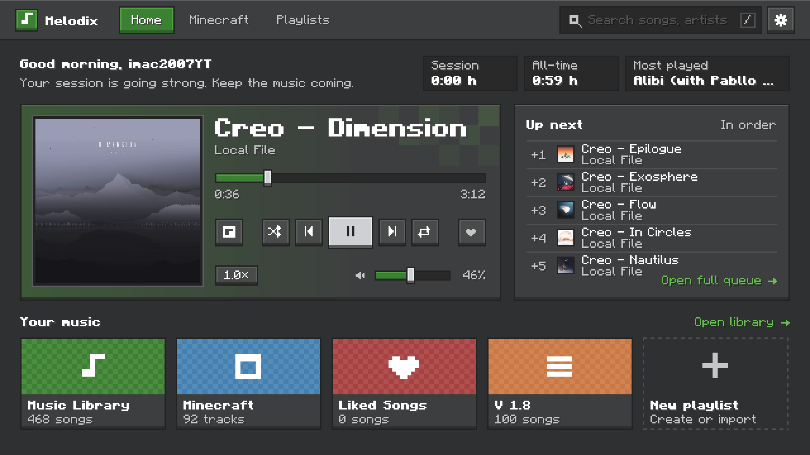
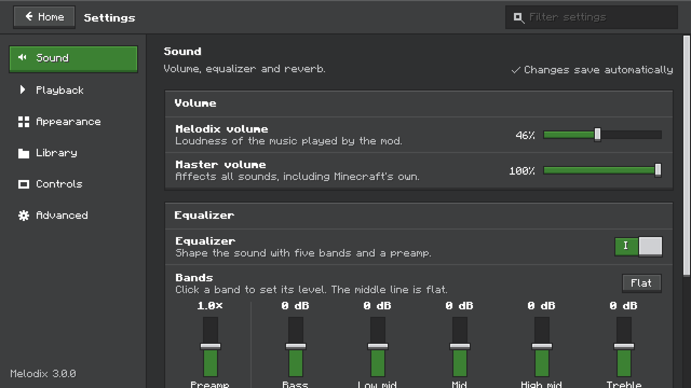
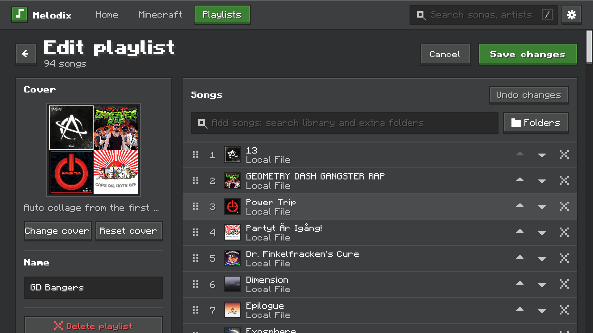

# Melodix Music Player

An in-game music player for Minecraft (Fabric, client-side only). Play your own MP3, WAV and FLAC files or listen to the Minecraft soundtrack directly from a full GUI, without leaving the game.

**Why use Melodix?** Listen to your own music while building, exploring, or mining. Playback is built into the HUD with a mini player, an audio visualizer, and notifications, and you can switch between your personal library and the vanilla soundtrack with one click.


*Home screen — now playing, up-next queue, listening stats and your library*


*Settings — sound, five-band equalizer with preamp and reverb*


*Playlist editor — reordering, covers and extra folders*

---

## Table of Contents

- [Features](#features)
- [Requirements](#requirements)
- [Installation](#installation)
- [Getting Started](#getting-started)
- [Usage](#usage)
- [Configuration](#configuration)
- [Keybindings](#keybindings)
- [Compatibility](#compatibility)
- [Troubleshooting](#troubleshooting)
- [Reporting Bugs](#reporting-bugs)
- [Building from Source](#building-from-source)
- [License](#license)

---

## Features

### Playback
- **Dual source playback:** play your own MP3/WAV/FLAC files or tracks from the Minecraft soundtrack, and switch between them with one click
- **Playback controls:** play/pause, next/previous track, seek via the progress bar, playback speed from 0.5x to 2x
- **Smooth fade:** tracks fade in and out instead of cutting off abruptly, with optional crossfade between tracks
- **Equalizer:** shape the sound with five bands and a preamp — 10 built-in presets (Flat, Bass Boost, Treble Boost, Vocal, Rock, Pop, Jazz, Classical, Electronic, Loudness) or save your own presets
- **Reverb:** a subtle room effect with an adjustable mix

### Library and playlists
- **In-game GUI:** Home, Minecraft and Playlists tabs with search across your library and extra folders
- **Playlist management:** create, import, edit and reorder playlists; export them as M3U or JSON
- **Built-in sections:** "Music Library" (your files), "Minecraft" (soundtrack) and "Liked Songs" are always there
- **Album art:** displays embedded ID3v2 APIC cover art from MP3 files, with custom covers you can set per song
- **Playlist covers:** auto-collage from the first four songs, or pick your own cover
- **Listening stats:** session and all-time listening hours and your most played songs
- **Up-next queue:** see and reorder what is coming next

### HUD
- **Mini player:** a movable, resizable overlay with playback controls, visible while a track is playing
- **Audio visualizer:** live 32-bar frequency display above the hotbar
- **Notifications:** now-playing notifications, toggleable in the settings

### Customization
- **Color themes:** Dark Minecraft, Light, Ocean, Nether, The End, Grass
- **Configurable keybindings** for playback, track navigation and volume
- **Pause behavior:** optionally pause the music when the game is paused, when a GUI is open, or when the window loses focus
- **Suppress vanilla music:** mute Minecraft's own soundtrack while Melodix is playing
- **Two UI styles:** the new Ore UI (default) or the classic screens

---

## Requirements

| Requirement | Version |
|---|---|
| Minecraft | 26.1.2, 26.2 or 26.3 (one JAR per version) |
| Fabric Loader | >= 0.19.2 |
| Fabric API | required |
| Java | 21 or newer (already included with the launcher) |
| Side | Client only (not needed on the server) |

---

## Installation

1. Install [Fabric Loader](https://fabricmc.net/use/) for your Minecraft version.
2. Download [Fabric API](https://modrinth.com/mod/fabric-api) and put it in your `mods` folder.
3. Download the Melodix JAR for your Minecraft version from the [Releases page](https://github.com/distelbus-svg/musicplayer-mod/releases) and put it in the same `mods` folder.
4. Launch the game.

Melodix is client-side only. Do not install it on a server.

---

## Getting Started

1. Launch the game and press **M** to open the music player.
2. Open the settings and pick your music folder under **Library** — any folder with MP3, WAV or FLAC files works.
3. Pick a source: **Music Library** (your files) or **Minecraft** (the soundtrack).
4. Select a track or playlist and press play.
5. Close the GUI. The mini player and visualizer keep running on your HUD.

Your last played song, source and queue are remembered between sessions.

---

## Usage

### Full-screen player
Open it with the default keybind (**M**). The Home tab shows what is playing with cover art, the up-next queue and your listening stats; the Minecraft tab browses the vanilla soundtrack; the Playlists tab manages your playlists. Search covers your music folder and any extra folders. From here you can also switch sources, seek through the current track, and open the settings.

### Mini player
Shown while music is playing. Drag it to move it and resize it to fit your HUD. It includes play/pause and next/previous controls.

### Playlists
- Create new playlists from the Playlists tab, or import existing ones.
- Add tracks (from your music folder or extra folders), remove tracks, and reorder them.
- Playlist covers are a collage of the first four songs — change or reset them anytime.
- Export a playlist as M3U or JSON from the playlist editor.
- "Liked Songs" collects everything you like with the heart button.

### Album art
If an MP3 has embedded cover art (ID3v2 APIC tag), it is shown in the player. You can also set a custom cover for any song. Files without art use a fallback cover.

### Visualizer
A 32-bar live frequency display rendered above the hotbar while audio is playing.

---

## Configuration

Config file: `.minecraft/config/musicplayer.json`

Everything can be changed in the in-game settings (sections: Sound, Playback, Appearance, Library, Controls, Advanced); changes save automatically. The file can also be edited while the game is closed.

| Option | Description |
|---|---|
| Melodix volume | Loudness of the music played by the mod |
| Master volume | Affects all sounds, including Minecraft's own |
| Suppress vanilla music | Mutes Minecraft's own soundtrack while Melodix is playing |
| Crossfade | Fade between tracks instead of a hard cut, with configurable duration |
| Fade on pause | Smooth volume fade when pausing and resuming |
| Playback speed | 0.5x to 2x |
| Equalizer | Five bands and a preamp, with built-in and custom presets |
| Reverb | Room effect with adjustable wet mix |
| Theme | Dark Minecraft, Light, Ocean, Nether, The End, Grass |
| Notifications | Enable or disable now-playing notifications |
| Visualizer / mini player | Toggle and position the HUD elements |
| Pause behavior | Pause when the game is paused, when a GUI is open, or when the window loses focus |
| UI style | New Ore UI (default) or classic screens |
| Music folders | Your music folder plus extra folders for playlist editing |

Data export and import lives in the settings: a single `.melodix` file with your settings, EQ presets, playlists, listening statistics and music folder.

If the config gets corrupted, delete `musicplayer.json` and restart the game to regenerate it.

---

## Keybindings

All keybindings can be changed under **Options → Controls**.

| Action | Default |
|---|---|
| Open music player | `M` |
| Play / Pause | `P` |
| Next track | `Right Arrow` |
| Previous track | `Left Arrow` |
| Volume up (+5%) | `Up Arrow` |
| Volume down (−5%) | `Down Arrow` |
| Set custom volume | unbound |

---

## Compatibility

- **Client-side only:** works in singleplayer and on any server, without anything installed server-side.
- **Other mods:** mods that heavily alter the sound engine may conflict. Please report any issues you find.

---

## Troubleshooting

**The player doesn't open.** Check that Fabric API is installed and that the keybind isn't conflicting with another mod (Options → Controls).

**My music files don't show up.** Make sure they are MP3, WAV or FLAC and that the folder is set under Settings → Library, then reopen the player.

**No album art.** Art is shown for MP3s with an embedded ID3v2 APIC tag, or for songs with a custom cover.

**Minecraft's own music keeps playing.** Enable "Suppress vanilla music" in the settings.

**Config problems.** Delete `.minecraft/config/musicplayer.json` and restart the game.

---

## Reporting Bugs

Please open an [issue](../../issues) and use the bug report form. **Always include:**

- Melodix version
- Minecraft version
- Fabric Loader and Fabric API versions
- What you expected and what happened
- `latest.log` (and the crash report, if there is one)

Reports without a version number can't be reproduced and may be closed.

---

## Building from Source

```bash
git clone https://github.com/distelbus-svg/musicplayer-mod.git
cd musicplayer-mod
./gradlew build
```

Built JARs land in each version folder's `build/libs/` directory (e.g. `26.3/build/libs/`). Building all versions in parallel is the default; Gradle provisions the required JDK automatically.

To verify just the shared modules (they must compile without Minecraft):

```bash
./gradlew :core:compileJava :ui:compileJava
```

See [ARCHITECTURE.md](ARCHITECTURE.md) for how the code is organized (`core/` and `ui/` are Minecraft-free; each version folder only holds its adapter).

---

## License

Melodix is open source under the [MIT License](LICENSE).
